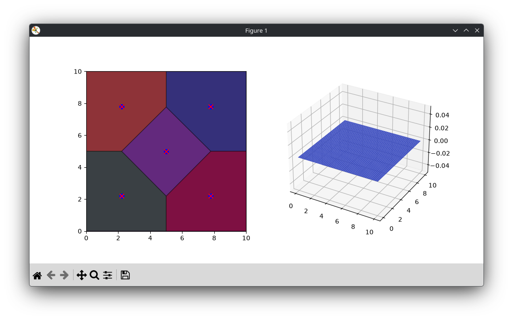

# quanser-swarm-control

## Quickstart
This setup assumes that `uv` is installed on the system. You can still do the same things without `uv`, though.

This setup applies for the `main_wo_quanser.py`. This won't work for the other `main*.py` files.
```
$ git clone https://github.com/michabay05/quanser-swarm-control
$ cd quanser-swarm-control
$ uv venv
$ source .venv/bin/activate
$ uv pip install -r requirements.txt
$ python main_wo_quanser.py
```

>[!warning]
>The above setup works on Mac/Linux. The only difference for windows would be virtual env activation step. For Windows, use `.\Scripts\bin\activate.bat`

After running it for a few seconds, it should look this.


## Overview
There are three major components in this repo:
- Coverage Algorithm
- Interactive UI
- Quanser

### Coverage Algorithm
The central algorithm implemented here is based on [this paper](https://mason.gmu.edu/~cnowzari/papers/cp01.pdf). This paper has two main components: _optimal deployment_ and _self-coordination_. This project focuses only the _optimal deployment_ section. 

This idea can essentially be boiled down into the following sentence:
>Given some region, there exists an _optimal deployment_ of agents throughout the region that maximizes coverage.

Refer to the image for an illustration of this concept. The illustration assumes an uniform density function throughout the entire space; therefore, the five agents (marked in 'red') have spread themselves to maximize coverage. 

Maximal coverage, in this context, implies that for a given random event somewhere within the region, the agents' configuration is one that minimize response time (assuming a constant agent velocity). However, if the density changes over time, the previous _optimal deployment_ is no longer "optimal". Therefore, the agents should reconfigure themselves by accounting for the non-uniform density.

This project makes the idea of changing density explorable by allowing the user to modify the density function, instead of hard-coding within the simulation. After the user modifies the density function, the algorithm will compute the next _optimal configuration_ at the timestep until it eventually settles on some configuration.

### Interactive UI
To visualize the adaptive process, this project uses `matplotlib` graphing and interactive capabilities. The window is divided into two sections: an aerial-view of the region and 3D plotting of the density function (optional but on by default).

On the 2D plot (shown above), there are five subdivisions (partitions) of the region (or domain). Within each subdivision, there are red crossmarks(X) and blue circles, which represent the agents and their target waypoint, respectively. The partitions of the domain are known as Voronoi partitions (more about Voronoi partitions/diagrams: [here](https://en.wikipedia.org/wiki/Voronoi_diagram)).

On the left side, the user can click on the plot at which point, the UI updates by adding countour lines on the 2D plot and graphing the current state of the user-defined density function on the 3D plot.

### Quanser
Once the program has reached some level of stability and completeness (I know it's vague but this should be soon...), this simulation will be physically implemented using [Quanser's QBot Platform (QBP)](https://www.quanser.com/products/qbot-platform/) as real-life experimental testbeds.

As the user tinkers with the density function, the coverage algorithm will compute the next waypoint for all the agents involved in the simulation, which will also be sent to the QBPs' in real life.
